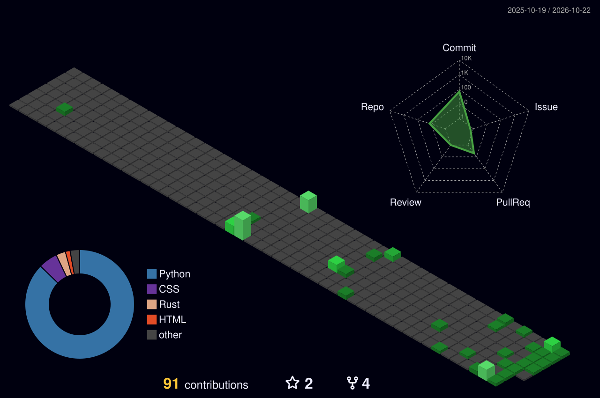
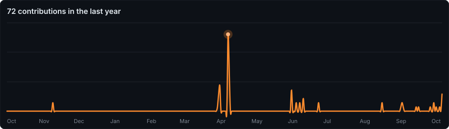

  

# 💫 About Me

🚀 B.Tech CSE (AI & ML) undergrad at CSMU, Panvel — working toward becoming an **AI Engineer**. I build **LLM apps, RAG systems and AI agents**, and I learn fastest under hackathon pressure (Meta × Hugging Face hackathons).

- 🔭 Currently building **Haq** — an AI wage-theft detector for Indian workers *(Nebius × NVIDIA Hackathon)*
- 🌱 Going deeper into **LLMs, RAG pipelines & agent frameworks**
- 💬 Ask me about **GenAI, RAG, AI agents, full-stack web dev**
- 📫 How to reach me: **sarodehrushikesh2006@gmail.com**
- ⚡ Fun fact: Maratha grit, neural networks.

# 🌐 Socials

# 💻 Tech Stack

**Languages**

**AI / GenAI**

**Web**

**Tools**

# 🚀 Featured Projects

- 🤖 **Mega Port Management AI Agent** — autonomous port-logistics agent (LLaMA + LangChain) · *Meta × Hugging Face Hackathon 2026*
- 🧾 **QB Solver** — question-bank PDFs → AI-generated answers, exported as PDF
- 🎧 **Customer Support OpenEnv** — Docker environment to evaluate AI support agents (ticket triage, KB search, escalation)
- 💸 **Stellar Payroll** — cross-currency payroll smart contract for freelancers *(Soroban / Rust)*

|  |  |
|---|---|
|  |  |

# 📊 GitHub Stats

<table>
<tr>
<td width="50%">

</td>
<td width="50%">

</td>
</tr>
</table>

<!-- generated daily by .github/workflows/profile-3d.yml -->

---

  

⭐ <i>Thanks for stopping by — let's build something intelligent.</i>

