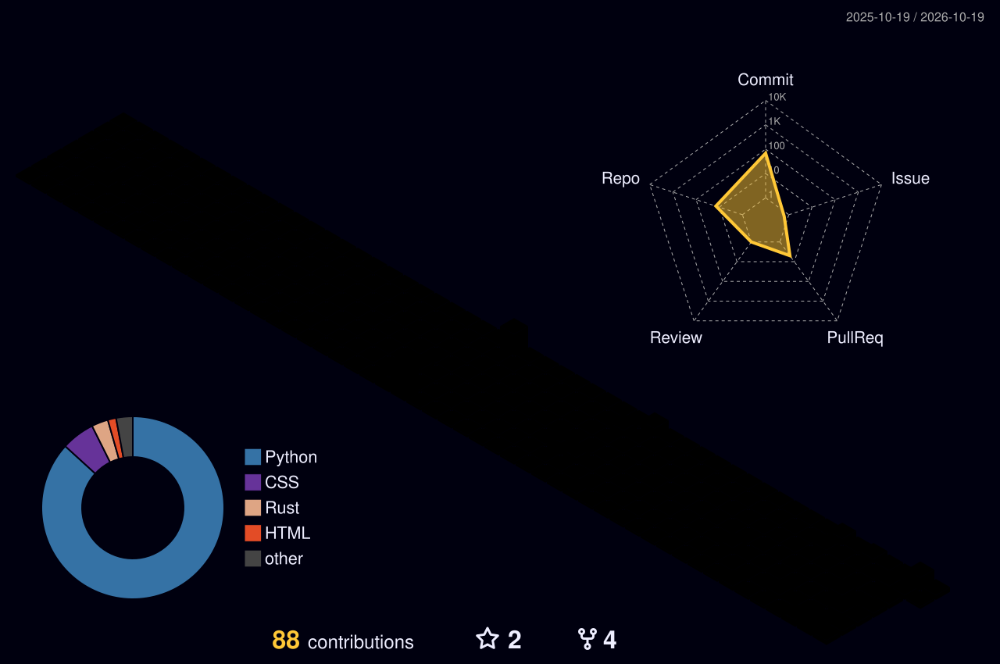

<!-- ╔══════════════════════════════════════════════════════════════════╗ -->
<!-- ║  NEURAL FORTRESS COMMAND CENTER — Legend2006H Profile README   ║ -->
<!-- ║  Animated SVGs (SMIL + CSS @keyframes) · Zero JavaScript      ║ -->
<!-- ╚══════════════════════════════════════════════════════════════════╝ -->

<div align="center">

<!-- ═══════════════════ HERO BANNER (dark/light) ═══════════════════ -->


<!-- ═══════════════════ TYPING SUBTITLE ═══════════════════ -->

<a href="https://github.com/Legend2006H">
  
</a>

</div>

<!-- ═══════════════════ DIVIDER ═══════════════════ -->


## ⚡ About Me

```text
> neurofort --whoami
```

🏰 **Hrushikesh Sarode** — B.Tech CSE (AI & ML), Chhatrapati Shivaji Maharaj University, Panvel · Class of 2028.
I build **LLM-powered agents, RAG pipelines, and full-stack AI systems** — and I learn fastest under hackathon pressure.

- 🔭 Currently building **[Haq](https://github.com/Legend2006H)** — an AI wage-theft detector for Indian workers *(Nebius × NVIDIA Hackathon)*
- 🧠 Going deeper into **LLMs, agent frameworks & multi-modal AI**
- 🏆 Goal: **AI Engineer** — shipping models that solve real-world problems

<!-- ═══════════════════ DIVIDER ═══════════════════ -->


## 🌐 Connect

<div align="center">

[](https://www.linkedin.com/in/hrushikesh-sarode-5b21693b9)
[](mailto:sarodehrushikesh2006@gmail.com)
[](https://github.com/Legend2006H)

</div>

<!-- ═══════════════════ DIVIDER ═══════════════════ -->


## 🛠️ Tech Stack

```text
> neurofort --stack
```

<div align="center">

**Languages**


**AI / GenAI**


**Backend & Database**


**Tools & Platforms**


</div>

<!-- ═══════════════════ DIVIDER ═══════════════════ -->


## 🏗️ Featured Projects

```text
> neurofort --projects --featured
```

<table>
<tr>
<td width="50%">

[](https://github.com/Legend2006H/Mega-Port-Command-final)

</td>
<td width="50%">

[](https://github.com/Legend2006H/Question-bank-pdf-solver-gives-answer-in-pdf)

</td>
</tr>
<tr>
<td width="50%">

[](https://github.com/Legend2006H/customer-support-agent-env)

</td>
<td width="50%">

[](https://github.com/Legend2006H/stellar)

</td>
</tr>
</table>

<!-- ═══════════════════ DIVIDER ═══════════════════ -->


## 📊 GitHub Stats

```text
> neurofort --stats
```

<table>
<tr>
<td width="50%">


</td>
<td width="50%">


</td>
</tr>
</table>

<!-- ═══════════════════ DIVIDER ═══════════════════ -->


## 🐍 Contribution Snake

```text
> neurofort --snake --animate
```

<div align="center">


</div>

> *Generated daily by [`.github/workflows/profile.yml`](.github/workflows/profile.yml) — zero external service dependency.*

<!-- ═══════════════════ DIVIDER ═══════════════════ -->


## 📈 3D Contribution Graph

```text
> neurofort --contrib --3d
```

<div align="center">



</div>

> *Rendered in-workflow via [yoshi389111/github-profile-3d-contrib](https://github.com/yoshi389111/github-profile-3d-contrib) — runs inside the repo, not an external service.*

<!-- ═══════════════════ DIVIDER ═══════════════════ -->


## 🌊 Contribution Activity Wave

```text
> neurofort --wave --theme neural-fort
```

<div align="center">


</div>

> *Custom-built Python script reads the GitHub GraphQL API and renders a themed SVG. [View source →](scripts/contribution_wave.py)*

<!-- ═══════════════════ DIVIDER ═══════════════════ -->


## 🏰 Neural Fort — Visitor Log

<div align="center">


<br/><br/>


<sub>

**⚔️ Built with Maratha grit and neural precision.**

*Star a repo if something helped you — let's build something intelligent together.*

</sub>

</div>
